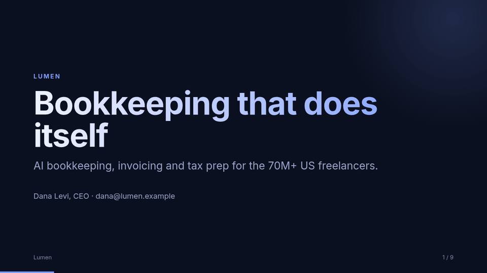
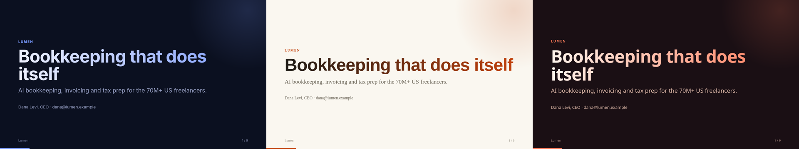

# founder-deck-skill

**Turn a messy founder brain-dump into an investor-ready HTML pitch deck.** One agent skill, works with Claude Code, Codex, Gemini CLI and any agent that reads `SKILL.md`.



- 📝 Paste notes, a memo or a call transcript → get a 10–13 slide deck
- 📦 **One self-contained `.html` file**: no dependencies, works offline, easy to email
- ⌨️ Arrow keys / click to navigate · `p` to print to PDF
- 🎨 3 themes: `midnight`, `paper`, `sunset`
- 🚫 Never invents numbers: missing data becomes a visible `[TODO]`

## Install (one line)

```bash
git clone --depth 1 https://github.com/Omrigotlieb/founder-deck-skill /tmp/fds && mkdir -p ~/.claude/skills && cp -r /tmp/fds/skills/founder-deck ~/.claude/skills/
```

For other agents, copy `skills/founder-deck` into that agent's skills folder (or the project's `.claude/skills/`).

## Use

In your agent:

> Make me a pitch deck from these notes: …

Or run the builder yourself (Node 18+, zero deps):

```bash
node skills/founder-deck/scripts/build.mjs examples/lumen.json deck.html --theme paper
```

## Themes



| midnight | paper | sunset |
|---|---|---|
| dark, tech / AI | warm editorial, B2B / fintech | bold, consumer |

## Example

- Input: [`examples/notes.md`](examples/notes.md) (raw brain-dump)
- Structured: [`examples/lumen.json`](examples/lumen.json)
- Output: [`lumen-midnight.html`](examples/lumen-midnight.html) · [`lumen-paper.html`](examples/lumen-paper.html) · [`lumen-sunset.html`](examples/lumen-sunset.html) (download and open in a browser)

## Slide types

`title`, `statement`, `bullets`, `metrics`, `columns`, `team`, `ask`. See the schema and design rules in [`SKILL.md`](skills/founder-deck/SKILL.md).

## More from me

- [ai-skills](https://github.com/Omrigotlieb/ai-skills): ready-made templates for AI coding agents
- [awesome-anthropic](https://github.com/Omrigotlieb/awesome-anthropic): curated Anthropic / Claude resources

## License

MIT · Made by the [Guti AI](https://gutiailabs.com) team, a calm AI workspace for solo founders.
